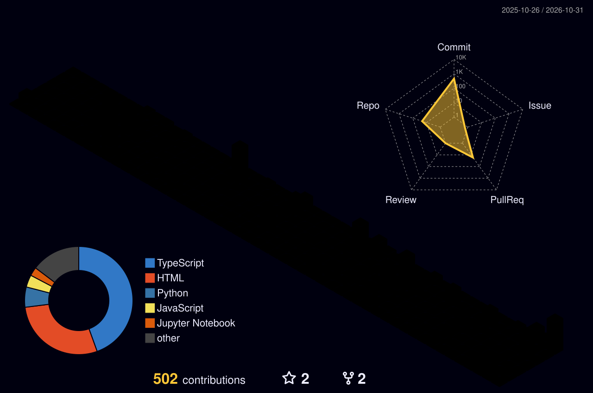

<div align="center">


<br/>


<br/>

<a href="https://github.com/PrateekSingh2"></a>
<a href="https://www.linkedin.com/in/rajawatprateeksingh/"></a>
<a href="https://prateekdev.me"></a>
<a href="https://algolib.prateekdev.me"></a>
<a href="mailto:prateeksinghrajawat2006@gmail.com"></a>

<br/><br/>


</div>

<br/>

<div align="center">

| 🚀 Product | 👥 Users | 🧠 LeetCode | 🏆 Hackathon | 📈 CGPA | ☁️ Cloud |
|:---:|:---:|:---:|:---:|:---:|:---:|
| **AlgoLib** | **1,500+** | **Knight · 1860** | **1st / 100+** | **8.76 / 10** | **AWS Builder** |

</div>

<br/>

---

## About Me

Second-year **B.Tech Artificial Intelligence** student at **MITS Gwalior**, and **Founder & Lead Software Engineer at AlgoLib** — a production DSA platform with **1,500+ cumulative users**, a multi-language execution engine, and 60fps visualizers.

I care about systems that feel fast and teach well: clean APIs, measurable performance, and interfaces people actually stay in (AlgoLib sessions average **15 minutes**). On the side I grind DSA (**1,000+** problems in C++ / Java), ship AI products with LangGraph + RAG, and take internships where I can write production Python.

```text
name      :  Prateek Singh
role      :  Founder @ AlgoLib  ·  AI / Full-Stack Engineer
school    :  B.Tech Artificial Intelligence — MITS Gwalior (2025 – 2029)
cgpa      :  8.76 / 10
location  :  Gwalior, Madhya Pradesh, India
web       :  https://prateekdev.me
email     :  prateeksinghrajawat2006@gmail.com
now       :  Scaling AlgoLib  ·  Schema AI  ·  SWE internships
```

> LinkedIn headline: *Founder @AlgoLib · LeetCode Knight · Competitive Programmer · DSA & LLD · 2★ CodeChef · 5★ HackerRank · 1× Hackathon winner · B.Tech AI ’29 @ MITS*

<p align="center">
  
</p>

## What I Ship

<table>
  <tr>
    <td width="25%" valign="top">
      <h3 align="center">AI Systems</h3>
      <p align="center"><sub>LangGraph · Vector RAG · NL → SQL/GraphQL · prompt compilers · execution guardrails · Vertex AI</sub></p>
    </td>
    <td width="25%" valign="top">
      <h3 align="center">Full-Stack</h3>
      <p align="center"><sub>React · Next.js · TypeScript · FastAPI · Node · REST · Firebase · Tailwind · Vercel / Netlify</sub></p>
    </td>
    <td width="25%" valign="top">
      <h3 align="center">Platforms</h3>
      <p align="center"><sub>Code execution engines · real-time visualizers · contest arenas · CI/CD · Docker · AWS EC2 / Lambda / S3</sub></p>
    </td>
    <td width="25%" valign="top">
      <h3 align="center">DSA / LLD</h3>
      <p align="center"><sub>1,000+ problems · Knight 1860 · DP · graphs · system design fundamentals · code reviews</sub></p>
    </td>
  </tr>
</table>

---

## Experience

### AlgoLib — Founder & Lead Software Engineer
**Jan 2026 – Present** · Gwalior · [Live product](https://algolib.prateekdev.me) · [Company](https://www.linkedin.com/company/algolib-official)

All-in-one CS education product: 60fps visualizers, notes, snippets, live contests, complexity analysis, online compiler, community.

- Scaled to **1,500+ users**; migrated a React + TypeScript stack into a modular **Next.js** frontend.
- Built a custom **C++ / Java / Python** execution engine and real-time visualizer; cut average run time by **~50%**.
- Lead a **5-person** team across engineering, UI/UX, testing, and marketing.
- Shipped **AlgoLib AI**: Big-O profiling, complexity-curve graphs, and structured problem deconstruction.

### DecodeLabs — Python Developer Intern
**Jun 2026 – Jul 2026** · Remote

- Designed an expense-tracking **REST API** with **Python + FastAPI**, modular OOP, query optimization, and caching (**26%** faster responses).
- Code reviews, debugging, and automated API validation at **98%** test coverage.

---

## Featured Work

<table>
<tr>
<td width="50%" valign="top">

### AlgoLib
**DSA learning OS — visualizer, compiler, contests, AI profiler**

1,500+ users · 15 min avg session · 5 languages · 10+ visualizers

`React` `Next.js` `TypeScript` `Node` `MongoDB` `AI`

[](https://algolib.prateekdev.me)
[](https://algolib.netlify.app)

</td>
<td width="50%" valign="top">

### Schema AI
**NL → SQL / GraphQL engine with React Flow ERDs**

98% accuracy / 100 prompts · &lt;3s responses · unsafe-query blocks · 30% faster execution

`Python` `LangGraph` `RAG` `Next.js` `Supabase` `React Flow`

[](https://ai-schema.netlify.app)
[](https://github.com/PrateekSingh2/SchemaAI)

</td>
</tr>
<tr>
<td width="50%" valign="top">

### FormsForge
**Prompt-to-form SaaS — drag-drop builder + instant APIs**

Next.js + TypeScript UI, Tailwind, Vercel CI/CD, live validation

`Next.js` `TypeScript` `Generative AI` `Vercel`

[](https://formsforge-coral.vercel.app)
[](https://github.com/PrateekSingh2/formsforge)

</td>
<td width="50%" valign="top">

### XYNC
**Project OS — tasks, sprints, auth, mixed data stores**

PostgreSQL + MongoDB schemas, Firebase auth, 64% faster page loads, 50+ teammate workflows

`React` `Node` `Express` `PostgreSQL` `Firebase`

[](https://github.com/PrateekSingh2/XYNC)

</td>
</tr>
<tr>
<td width="50%" valign="top">

### Verdictum — Stellar Hack 2026
**1st place · 100+ teams · Cosmic Tribunal dashboard**

Winning full-stack architecture for a frontend-heavy judging experience.

`Hackathon` `Frontend` `Product`

[](https://code-slayers.netlify.app/)
[](https://github.com/PrateekSingh2/Stellar)

</td>
<td width="50%" valign="top">

### More builds
- [Avsar NGO](https://github.com/PrateekSingh2/AvsarNGO) — interactive learning site for kids
- [AI Club Events](https://event-platform-ai-club-olive.vercel.app) — campus event platform
- [BLO](https://github.com/PrateekSingh2/BLO) — Class 12 voter-card desktop app (Tkinter + MySQL)

</td>
</tr>
</table>

<p align="center">
  <a href="https://github.com/PrateekSingh2/SchemaAI"></a>
  <a href="https://github.com/PrateekSingh2/formsforge"></a>
</p>
<p align="center">
  <a href="https://github.com/PrateekSingh2/Stellar"></a>
  <a href="https://github.com/PrateekSingh2/XYNC"></a>
</p>

---

## Tech Stack

**Languages**


<p align="center">
  
</p>

**Frontend · Backend · Data**

<p align="center">
  
</p>

**AI · Cloud · DevOps**

<p align="center">
  
</p>

<p align="center">
  
  
  
  
  
  
  
  
  
  
</p>

**Coursework:** Data Structures & Algorithms · OOP · DBMS · Operating Systems · REST · Software Engineering

---

## Competitive Programming

<div align="center">

| Platform | Handle | Highlight |
|:---|:---|:---|
| [LeetCode](https://leetcode.com/u/prateek_singh7) | `prateek_singh7` | Knight · **peak 1860** · 1000+ DSA |
| [CodeChef](https://www.codechef.com/users/nice_trail_87) | `nice_trail_87` | **2★ · 1438** |
| [HackerRank](https://www.hackerrank.com/prateeksinghraj2) | `prateeksinghraj2` | **5★ Gold** Problem Solving |
| [Codeforces](https://codeforces.com/profile/rajawatprateeksingh) | `rajawatprateeksingh` | Contests · greedy · number theory |

<br/>


<br/>

<a href="https://leetcode.com/u/prateek_singh7"></a>
<a href="https://www.codechef.com/users/nice_trail_87"></a>
<a href="https://www.hackerrank.com/certificates/cb7a3ae0e4bf"></a>

</div>

---

## GitHub Analytics

<div align="center">
  <picture>
    <source media="(prefers-color-scheme: dark)" srcset="https://github-readme-stats.vercel.app/api?username=PrateekSingh2&show_icons=true&include_all_commits=true&count_private=true&role=OWNER,COLLABORATOR,ORGANIZATION_MEMBER&theme=tokyonight&hide_border=true&bg_color=0d1117&title_color=c4b5fd&icon_color=a78bfa&text_color=c9d1d9&ring=7c3aed&rank_icon=github&cache_seconds=1800" />
    <source media="(prefers-color-scheme: light)" srcset="https://github-readme-stats.vercel.app/api?username=PrateekSingh2&show_icons=true&include_all_commits=true&count_private=true&theme=default&hide_border=true&rank_icon=github&cache_seconds=1800" />
    
  </picture>
  <picture>
    <source media="(prefers-color-scheme: dark)" srcset="https://streak-stats.demolab.com?user=PrateekSingh2&theme=tokyonight&hide_border=true&background=0d1117&ring=7c3aed&fire=a78bfa&currStreakLabel=c4b5fd&cache_seconds=1800" />
    <source media="(prefers-color-scheme: light)" srcset="https://streak-stats.demolab.com?user=PrateekSingh2&theme=default&hide_border=true&cache_seconds=1800" />
    
  </picture>
</div>

<br/>

<div align="center">
  
</div>

<br/>

<div align="center">
  
</div>

<br/>

<div align="center">
  
</div>

<br/>

---

## Generated Visuals

These refresh from GitHub Actions (run **Actions → workflow → Run workflow** once after you push).

<div align="center">

### Contribution snake

<picture>
  <source media="(prefers-color-scheme: dark)" srcset="https://raw.githubusercontent.com/PrateekSingh2/PrateekSingh2/output/github-contribution-grid-snake-dark.svg" />
  <source media="(prefers-color-scheme: light)" srcset="https://raw.githubusercontent.com/PrateekSingh2/PrateekSingh2/output/github-contribution-grid-snake.svg" />
  
</picture>


### 3D contribution graph



### Metrics snapshot


</div>

---

## Education & Certifications

**B.Tech, Artificial Intelligence** — Madhav Institute of Technology & Science, Gwalior  
Aug 2025 – Jul 2029 (expected) · CGPA **8.76 / 10**

**Class XII (CBSE)** — Vidyavati Public Central School, Bhind · 77.4% · 2024

<p align="center">
  <a href="https://www.hackerrank.com/certificates/cb7a3ae0e4bf"></a>
  <a href="https://www.coursera.org/account/accomplishments/records/SSH0I8PKNBHB"></a>
  <a href="https://www.cloudskillsboost.google/public_profiles/1fe1133c-6688-47b3-83bc-85c36270e299/badges/17573345"></a>
  <a href="https://life-global.org/certificate/6e997696-934a-43a7-bfb5-2f7c520f8bf8"></a>
  
  
  
</p>

---

## Currently

```text
building   AlgoLib scale + AI profiler · Schema AI · FormsForge
learning   Agentic systems · LangGraph · AWS Solutions Architect path
goal       Stronger contest rating · AlgoLib toward 10k learners
open to    SWE internships (backend, AI/ML, full-stack)
           product companies · open source · remote / hybrid
```

---

<div align="center">

### Let’s build something that ships

<a href="https://www.linkedin.com/in/rajawatprateeksingh/"></a>
<a href="mailto:prateeksinghrajawat2006@gmail.com"></a>
<a href="https://prateekdev.me"></a>
<a href="https://algolib.prateekdev.me"></a>

<br/><br/>


</div>
